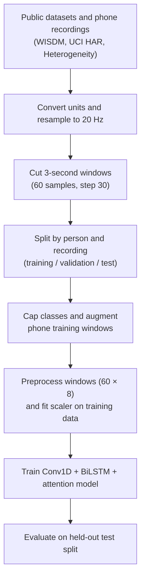
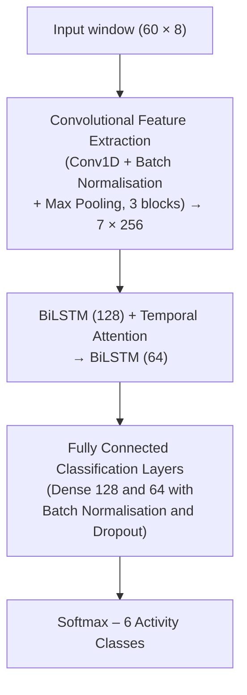
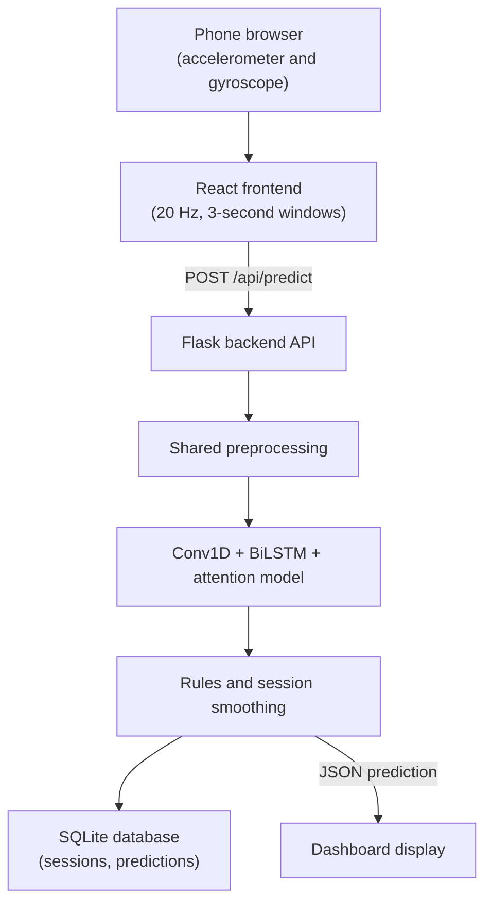
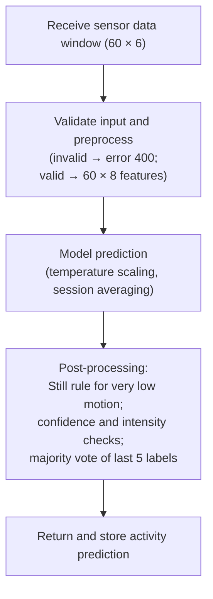

## CHAPTER 4: PROPOSED METHODOLOGY AND WORK DESCRIPTION

### 4.1 System Overview

The system has a client-server structure with four parts: (a) a web dashboard that runs in the phone's browser and reads the motion sensors, (b) a Flask server that preprocesses the data and runs the model, (c) a local SQLite database that stores recording sessions and predictions, and (d) an optional cloud module for sign-in and AI-generated reports, which is switched off unless credentials are configured.

The browser samples the accelerometer (m/s², including gravity) and the gyroscope (converted from degrees per second to radians per second) every 50 ms, that is at 20 Hz. After the first 60 samples (3 seconds) it sends the most recent 60 samples to the server, and then repeats this every 30 new samples (1.5 seconds), so consecutive windows overlap by 50 percent. The server converts the 60 × 6 window into a 60 × 8 feature window with the same function that was used to build the training data, normalises it, runs the neural network, applies post-processing rules and per-session smoothing, stores the prediction, and returns it to the dashboard.

The model is trained offline with the pipeline described in Sections 4.2 to 4.8. The trained network, its fitted scaler and its label encoder are stored together in one model folder, which the server loads and checks at start-up (Section 7.3). Sessions and predictions are stored in a local SQLite database (backend/data/har.db) that needs no installation or credentials. The optional cloud module (backend/cloud_reports.py) adds Google sign-in, MongoDB logging and Gemini-generated daily reports when credentials are configured; no credentials were available, so it was not tested and is not part of the evaluated system.

### 4.2 Data Sources

The training and test data come from three public datasets and the project's own phone recordings (Table 2). All four sources contain three-axis accelerometer and three-axis gyroscope readings from a smartphone.

**Table 2: Data Sources Used for Training and Testing**

| Source | People | Phone position | Original rate and units | Windows |
|--------|--------|----------------|-------------------------|------------------------------|
| WISDM 2019 [8], [16] | 51 | Pocket | 20 Hz; m/s² with gravity; rad/s | 77,484 |
| Heterogeneity [7], [9] | 9 | Not stated | Highest rate of each device; units not stated (Android default of m/s² and rad/s assumed) | 44,014 |
| UCI HAR [1] | 30 | Waist | 50 Hz; acceleration in g; rad/s | 8,186 |
| Project phone recordings | Not documented | Not documented | Varies by file (for example 44–52 Hz accelerometer and 15–22 Hz gyroscope in the Stairs session); m/s² and rad/s | 395 |
| **Total** | | | | **130,079** |

The phone recordings were made with an Android sensor-logging application (rows of Timestamp, Sensor Type, Value1–3; type 1 is the accelerometer and type 4 the gyroscope). Six labelled recordings are used: one Still, one Jogging, two Walking and two Stairs files. Their timestamps show that the two Stairs files cover the same 95 seconds at different sampling rates, so they are one stair-climbing session recorded on two devices. Three further files are byte-identical copies of other recordings and are excluded.

### 4.3 Converting All Sources to a Common Format

The live application always sends acceleration in m/s² including gravity, angular velocity in rad/s, and samples spaced exactly 50 ms apart. The pipeline therefore converts every source into this format before any window is cut:

- **UCI HAR.** The total-acceleration signals (in g, with gravity) are multiplied by 9.80665 to obtain m/s². The dataset is distributed as 2.56-second windows with 50 percent overlap; consecutive windows of the same person and activity are joined back into continuous 50 Hz signals where their overlapping halves match, and these signals are resampled to 20 Hz with a polyphase filter that includes anti-aliasing.
- **WISDM.** The timestamps are converted from nanoseconds to milliseconds, and the accelerometer and gyroscope readings of each subject and activity are aligned by time and interpolated onto a common 20 Hz grid.
- **Heterogeneity.** The readings of each user, device and activity are aligned by time in the same way; the null class is dropped.
- **Phone recordings.** The files are read with parse_sensor_csv, the same function that the server uses for uploaded CSV files.

For all sources, the alignment step splits the data wherever either sensor has a gap of more than one second, so gaps are never filled by interpolation. Each continuous segment is then cut into windows of 60 samples (3 seconds) with a step of 30 samples. The windows are stored with their activity label, source, person (or recording) and split in one file. Figure 1 shows the complete data preparation and training pipeline.

<!-- maxh=562 -->


**Figure 1: Data Preparation and Training Pipeline**

### 4.4 Activity Class Mapping

The activity lists of the sources are merged into six classes (Table 3). Activities outside these classes, such as the eating and drinking activities of WISDM (codes H to L) and the null class of the Heterogeneity dataset, are not used, so the model cannot recognise them.

**Table 3: Activity Class Mapping**

| Class | WISDM codes | Heterogeneity labels | UCI HAR labels | Phone recordings |
|-------|-------------|----------------------|----------------|------------------|
| Walking | A (walking) | walk | 1 (walking) | 2 files |
| Jogging | B (jogging) | — | — | 1 file |
| Stairs | C (stairs) | stairsup, stairsdown | 2, 3 (upstairs, downstairs) | 2 files (one session) |
| Still | D (sitting), E (standing) | sit, stand | 4, 5, 6 (sitting, standing, lying) | 1 file |
| Hand Activity | F (typing), G (teeth), Q (writing), R (clapping), S (folding) | — | — | — |
| Sports | M (kicking), O (catch), P (dribbling) | bike | — | — |

Stairs combines climbing up and climbing down, so the model cannot tell the two directions apart. Hand Activity and Sports have no phone recordings, so they cannot be tested on the project's own phone data.

### 4.5 Data Splitting, Augmentation and Class Balance

**Splitting by person.** The data are divided before any augmentation, and no person appears in more than one split (Table 4). For WISDM, ten subjects form the test set and five the validation set; for the Heterogeneity dataset, two users and one user; for UCI HAR, the nine official test subjects form the test set and three of the official training subjects the validation set. The subjects were chosen by a seeded random shuffle (seed 42) before any results were seen. Among the phone recordings, the stair-climbing session (both files) and one Walking recording are kept for testing, and the Still, Jogging and the other Walking recording are used for training. No phone Stairs data is therefore used for training.

**Table 4: Division of the Data by Person and Recording (windows before capping and augmentation)**

| Source | Training | Validation | Test |
|--------|----------|------------|------|
| WISDM | 36 people, 54,575 windows | 5 people, 7,552 | 10 people, 15,357 |
| Heterogeneity | 6 people, 29,524 | 1 person, 4,834 | 2 people, 9,656 |
| UCI HAR | 18 people, 4,905 | 3 people, 942 | 9 people, 2,339 |
| Phone recordings | 3 recordings, 230 | — | 3 recordings, 165 |
| **Total** | **89,234** | **13,328** | **27,517** |

**Capping.** To keep the training time on a laptop CPU reasonable, at most 2,500 training windows per class are taken from each public dataset, sampled across all training subjects, and at most 600 validation windows per class and dataset. Phone windows are never capped.

**Augmentation.** Only the training part is augmented, and only the few phone recordings, each window receiving ten augmented copies. Each copy applies changes that a real phone could produce: a random three-dimensional rotation applied to the accelerometer and gyroscope together (as if the phone were turned in the pocket), a change of amplitude of up to 10 percent, and small sensor noise (standard deviation 0.05 m/s² and 0.01 rad/s). Rotation was the most useful single augmentation in the study of Um et al. [26]. Augmentation is applied to the raw six-channel signal, before the magnitude channels are calculated, so the magnitudes cannot become negative.

**Class balance.** After capping and augmentation the training set contains 32,167 windows (Still 8,633, Walking 6,510, Stairs 6,320, Sports 5,000, Jogging 3,204 and Hand Activity 2,500), and the validation set 6,912 windows. The remaining imbalance is handled by balanced class weights, which give each class the same total weight in the loss: Hand Activity 2.14, Jogging 1.67, Sports 1.07, Stairs 0.85, Walking 0.82 and Still 0.62.

### 4.6 Signal Preprocessing

Every 60 × 6 window, from the training data, an uploaded CSV file or the live phone, is converted into a 60 × 8 feature window by the same function (preprocess_window in backend/preprocessing.py; Algorithm 2), so the model always receives input processed exactly like its training data.

1. **Noise reduction.** A third-order Butterworth low-pass filter with a cut-off frequency of 5 Hz is applied to each of the six channels. Human movements such as steps lie mostly below this frequency. The filter is applied forwards and backwards (zero-phase filtering with scipy.signal.sosfiltfilt), so it does not shift the signal in time.
2. **Gravity separation.** A second Butterworth low-pass filter with a cut-off of 0.3 Hz extracts the slowly changing gravity component from the filtered accelerometer channels. Subtracting it gives the body acceleration, which depends on the movement rather than on how the phone is held.
3. **Magnitude features.** Two channels are added: the magnitude of the body acceleration, √(bx² + by² + bz²), and the magnitude of the angular velocity, √(gx² + gy² + gz²). Magnitudes do not change when the phone rotates in the pocket.
4. **Normalisation.** Each of the eight channels is standardised with a StandardScaler (subtracting the mean and dividing by the standard deviation). The scaler is fitted on the training windows only, and the fitted scaler is saved with the model (scaler.pkl) and reused at inference time.

The output channels are body acceleration x, y, z, angular velocity x, y, z and the two magnitudes. Filtering is done separately for each window and no filter state is kept between requests, so different sessions cannot influence each other.

### 4.7 Model Architecture

The network (create_model in backend/train_model.py) maps a normalised 60 × 8 window to six class probabilities in four stages: convolutional feature extraction, bidirectional recurrent modelling, temporal attention and classification (Figure 2). All convolutional, recurrent and dense layers use L2 weight regularisation (5 × 10^{−5}), and the model has 840,647 parameters.

**Conv1D feature extraction.** Three convolutional blocks extract local motion patterns, such as the acceleration peak of a footstep, and shorten the sequence. Block 1 has two Conv1D layers with 64 filters (kernel sizes 5 and 3; a kernel of five samples spans 250 ms), block 2 two layers with 128 filters (kernel size 3) and block 3 one layer with 256 filters (kernel size 3). Every convolution uses ReLU activation and batch normalisation, and every block ends with max pooling and dropout (0.15, 0.2 and 0.2). The sequence is reduced from 60 × 8 to 30 × 64, 15 × 128 and finally 7 × 256.

**BiLSTM temporal modelling.** A bidirectional LSTM with 128 units per direction reads the seven feature vectors forwards and backwards and returns the full sequence h_{1}, …, h_{7} (7 × 256), followed by dropout 0.25. Each h_{t} therefore describes one step of the window in the context of both the preceding and the following steps.

**Temporal attention.** A dense layer with 256 tanh units and a dense layer with one output assign a score e_{t} to every step, a softmax over the seven steps turns the scores into weights α_{t}, and each step is rescaled by its weight, where W, b, w and c are the weights and biases of the two dense layers:

$$e_{t} = w^{T} tanh(W h_{t} + b) + c,     t = 1, …, 7$$ (4.1)

$$α_{t} = exp(e_{t}) / Σ_{k=1}^{7} exp(e_{k})$$ (4.2)

$$z_{t} = α_{t} h_{t}$$ (4.3)

The weighted sequence z_{1}, …, z_{7} keeps its shape (7 × 256), so that the next layer can still use the temporal order.

**Summary and classification.** A second bidirectional LSTM with 64 units per direction summarises the weighted sequence into one 128-value vector (dropout 0.3). Dense layers with 128 and 64 ReLU units, each followed by batch normalisation and dropout (0.3 and 0.2), and a six-unit softmax output layer produce the class probabilities.

<!-- maxh=377 -->


**Figure 2: Conv1D–BiLSTM–Attention Model Architecture**

### 4.8 Training Configuration

The model is trained with the following settings:

- **Loss function:** focal loss with γ = 2 and α = 0.25. Focal loss multiplies the cross-entropy of each window by (1 − p)^γ, where p is the probability given to the correct class, so windows that are already classified confidently contribute little and training concentrates on difficult windows.
- **Class weights:** balanced class weights computed with scikit-learn (Section 4.5).
- **Optimiser:** Adam with an initial learning rate of 0.001; the learning rate is halved when the validation loss has not improved for five epochs (minimum 10^{−6}).
- **Batch size:** 64.
- **Early stopping:** training stops when the validation accuracy has not improved for 15 epochs, and the weights of the best epoch are restored.

The model was trained once with these settings for at most 60 epochs. Training stopped after 53 epochs and kept the weights of epoch 38, which had the highest validation accuracy (83.6 percent on the validation subjects).

### 4.9 Real-Time Prediction Pipeline

For each window received from the browser, the server (backend/app.py, backend/model_service.py) performs the steps given formally as Algorithm 3 and shown in Figure 4. The request must contain a 60 × 6 array of finite numbers (otherwise HTTP 400). The window is preprocessed and normalised (Section 4.6), and the six class probabilities are softened with a fixed temperature of 1.5 and averaged within the session with an exponential moving average (weight 0.4 for the newest window). If the summed per-axis variances of both the raw accelerometer and the raw gyroscope are below 0.12, the label is Still with confidence 1.0. Otherwise, an averaged probability below 0.40 gives the label Uncertain, and the total motion variance limits the allowed classes: below 0.8 only Still and Hand Activity, below 2.0 also Stairs, below 5.0 also Walking and Jogging, and otherwise all classes; a disallowed class is replaced by the most probable allowed one. The final label is the most frequent of the session's last five labels, and it is stored if a session is active.

The response contains the final label, the network's own top class, the confidence, all probabilities and the name of any rule that changed the result. The temperature and rule thresholds were set by hand and were not tuned on the test data.

## CHAPTER 5: PROPOSED ALGORITHMS

This chapter gives the three main procedures of the system: data preparation and training (prepare_data_v2.py, backend/train_model_v2.py), the shared window preprocessing (backend/preprocessing.py) and real-time prediction (backend/app.py, backend/model_service.py).

### 5.1 Data Preparation and Model Training

```algorithm
Algorithm 1: Data Preparation and Model Training
Input: UCI HAR, WISDM and Heterogeneity recordings; labelled phone CSV files; class map M (Table 3)
Output: trained network f, fitted scaler S, label encoder E
1: W ← ∅
2: **for each** source s ∈ {UCI HAR, WISDM, Heterogeneity, phone} **do**
3:     convert acceleration to m/s² (UCI HAR: total acceleration × 9.80665) and angular velocity to rad/s
4:     align accelerometer and gyroscope readings by timestamp and resample to 20 Hz
5:     split the signal into continuous segments at every gap longer than 1 s
6:     cut each segment into 60-sample windows with step 30 and map their labels with M
7:     assign each window to the training, validation or test split by person (public data) or by recording (phone data), seed 42
8:     W ← W ∪ windows of s
9: **end for**
10: D_{train} ← training windows of W, at most 2,500 per class and dataset; phone windows are not capped
11: D_{val} ← validation windows of W, at most 600 per class and dataset
12: **for each** phone window x ∈ D_{train} **do**
13:     **repeat** 10 times: add a copy with random 3-D rotation, amplitude factor U(0.9, 1.1) and sensor noise to D_{train}
14: **end for**
15: X_{train} ← PREPROCESS(D_{train});  X_{val} ← PREPROCESS(D_{val})     *// Algorithm 2, 60 × 8 per window*
16: fit S on X_{train} only; compute balanced class weights from D_{train}
17: f ← CREATE_MODEL()     *// Section 4.7*
18: train f on S(X_{train}) with focal loss (γ = 2, α = 0.25), Adam (learning rate 10^{-3}) and batch size 64
19: stop when the accuracy on S(X_{val}) has not improved for 15 epochs and restore the best weights
20: **return** f, S, E
```

### 5.2 Window Preprocessing

```algorithm
Algorithm 2: Window Preprocessing (PREPROCESS)
Input: raw window x of 60 samples × 6 channels (accelerometer a in m/s², gyroscope g in rad/s)
Output: feature window of 60 samples × 8 channels
1: **for each** channel of x **do**
2:     apply a third-order Butterworth low-pass filter (5 Hz) forwards and backwards
3: **end for**
4: g_{a} ← zero-phase Butterworth low-pass of the filtered accelerometer channels (0.3 Hz)     *// gravity*
5: b ← filtered accelerometer channels − g_{a}     *// body acceleration*
6: m_{b} ← ‖b‖ and m_{g} ← ‖filtered gyroscope channels‖ for every sample
7: **return** [b, filtered gyroscope channels, m_{b}, m_{g}]
```

### 5.3 Real-Time Prediction

```algorithm
Algorithm 3: Real-Time Prediction for One Window
Input: raw window x (60 × 6); network f; scaler S; session state: averaged probabilities p̄ and label history H
Output: final label y, network class ŷ, confidence c, applied rule r, class probabilities p
1: **if** shape(x) ≠ (60, 6) **or** x contains a non-finite value **then return** HTTP 400 error
2: q ← f(S(PREPROCESS(x)))     *// Algorithm 2*
3: p ← softmax(log q / T) with T = 1.5;  ŷ ← argmax p
4: **if** p̄ is empty **then** p̄ ← p **else** p̄ ← 0.4 p + 0.6 p̄
5: y ← argmax p̄;  c ← max p̄;  r ← none
6: v_{a} ← sum of per-axis variances of the raw accelerometer;  v_{g} ← same for the raw gyroscope
7: **if** v_{a} < 0.12 **and** v_{g} < 0.12 **then**
8:     y ← Still;  c ← 1.0;  r ← low-variance-still;  reset p̄ to Still
9: **else**
10:     **if** c < 0.40 **then** y ← Uncertain
11:     A ← classes allowed for the intensity v_{a} + v_{g} (limits 0.8, 2.0 and 5.0, Section 4.9)
12:     **if** y ∉ A **and** y ≠ Uncertain **then** y ← most probable class of p̄ in A;  c ← p̄ of y;  r ← intensity-gate
13: **end if**
14: append y to H;  y ← most frequent label among the last five entries of H
15: **if** the window belongs to a session **then** store (y, ŷ, c, r, p) in SQLite
16: **return** y, ŷ, c, r, p
```

## CHAPTER 6: PROPOSED FLOWCHARTS AND DIAGRAMS

### 6.1 System Architecture Diagram

Figure 3 shows the main components of the system and the data flow between them.

<!-- maxh=486 -->


**Figure 3: High-Level System Architecture**

### 6.2 Prediction Pipeline Flowchart

Figure 4 shows the main steps taken for every window received from the browser (Section 4.9).

<!-- maxh=399 -->


**Figure 4: Prediction Pipeline Flowchart**
