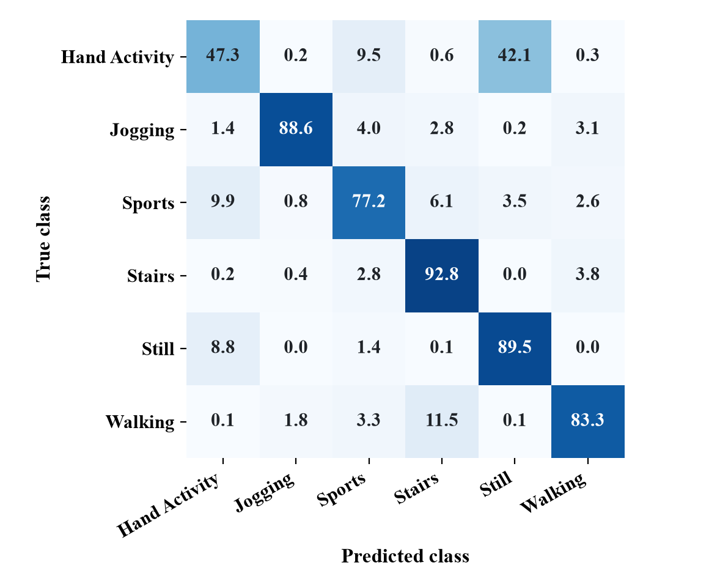

## CHAPTER 8: RESULT DISCUSSION AND ANALYSIS

### 8.1 Evaluation Design and Metrics

All results in this chapter were produced by the project's evaluation scripts (backend/evaluate.py and backend/compare_models.py), which use the same preprocessing and inference code as the live application. The metrics on the public held-out subjects were additionally recomputed from the saved test windows and the trained model files for this report, and they agree exactly with the saved evaluation output. The test subjects and recordings were fixed before training, and no setting was tuned on them. Each result belongs to one of the test sets in Table 6.

**Table 6: Test Sets Used in the Evaluation**

| Test set | Content | Used for training? | Results in |
|----------|---------|--------------------|-----------|
| Public held-out subjects | 27,352 windows from 10 WISDM subjects, 2 Heterogeneity users and the 9 UCI HAR test subjects | No | Tables 7 and 8; Figure 5 |
| Phone Stairs session | 117 windows: two files of one stair-climbing session recorded on two devices | No | Table 9 |
| Held-out phone walking recording | 48 windows | No | Table 9 |
| Phone recordings seen in training | 230 windows: Still, Jogging and one Walking recording | Yes | Table 9 |

Accuracy is the fraction of correctly classified windows. For each class, precision is TP / (TP + FP) and recall TP / (TP + FN), where TP, FP and FN are the true positives, false positives and false negatives, and the F1-score is their harmonic mean; macro values are unweighted averages over the classes present. For a phone recording, all windows share one true class, so its accuracy equals the recall of that class. "Model output" is the network's top class; "dashboard pipeline" is the label after the rules and smoothing of Section 4.9, which is what a user sees.

### 8.2 Results on Held-Out Public-Dataset Subjects

Table 7 gives the per-class and overall results of the model output on the 27,352 windows of the 21 held-out subjects, and Figure 5 shows the confusion matrix as percentages of each true class. The diagonal of the confusion matrix contains 21,308 correctly classified windows, which gives the accuracy of 0.779.

**Table 7: Per-Class and Overall Results on Held-Out Public-Dataset Subjects (model output)**

| Class | Precision | Recall | F1-score | Windows (support) |
|-------|-----------|--------|----------|-------------------|
| Hand Activity | 0.707 | 0.473 | 0.567 | 5,908 |
| Jogging | 0.888 | 0.886 | 0.887 | 1,181 |
| Sports | 0.798 | 0.772 | 0.785 | 4,893 |
| Stairs | 0.846 | 0.928 | 0.885 | 4,571 |
| Still | 0.711 | 0.895 | 0.793 | 7,340 |
| Walking | 0.889 | 0.833 | 0.860 | 3,459 |
| **Macro average** | **0.807** | **0.798** | **0.796** | 27,352 |
| **Accuracy** | | | **0.779** (21,308 of 27,352) | 27,352 |

**Figure 5: Confusion Matrix on Held-Out Public-Dataset Subjects (percentage of each true class)**

**Table 8: Results per Source Dataset (held-out subjects, model output)**

| Source | Held-out subjects | Windows | Accuracy | Macro F1-score (classes present) | Stairs recall |
|--------|-------------------|---------|----------|----------------------------------|---------------|
| WISDM | 10 | 15,357 | 63.5% | 0.671 | 0.757 |
| Heterogeneity | 2 | 9,656 | 96.0% | 0.964 | 0.985 |
| UCI HAR | 9 | 2,339 | 97.9% | 0.979 | 0.994 |

The results can be interpreted as follows:

1. **Stairs is recognised on data from new people.** Of the 4,571 true Stairs windows, 4,240 are classified correctly (recall 0.928). The model predicts Stairs for 5,013 windows in total, of which these 4,240 are correct (precision 0.846); the remaining 773 Stairs predictions are mainly Walking windows (398) and Sports windows (298). Stairs recall is 0.757 on the WISDM subjects, 0.985 on the Heterogeneity users and 0.994 on the UCI HAR subjects (Table 8).
2. **Hand Activity is the weakest class.** Only 2,794 of the 5,908 Hand Activity windows are found (recall 0.473), and 2,489 of them are predicted as Still. Hand Activity comes only from WISDM, where the phone was in the pocket while the hands typed, wrote or folded clothes, so the phone records little more than a standing or sitting person (Section 2.3). The confusion in the other direction (649 Still windows predicted as Hand Activity) lowers the precision of both classes and is the main reason why the accuracy on the WISDM subjects (63.5 percent) is lower than on the other two datasets.
3. **The overall accuracy is below the target.** The accuracy of 77.9 percent is below the 80 percent objective of Section 3.2. Excluding the WISDM subjects, the accuracy exceeds 96 percent, so the shortfall is concentrated in the Hand Activity–Still confusion.

### 8.3 Results on Phone Recordings

Table 9 gives the results on the labelled phone recordings, both for the model output and for the full dashboard pipeline.

**Table 9: Results on Phone Recordings (accuracy of model output / of dashboard pipeline)**

| Recording | True class | Used for training | Windows | Model output | Dashboard pipeline |
|-----------|------------|-------------------|---------|--------------|--------------------|
| Stairs session, device 1 | Stairs | No | 63 | 61.9% (39) | 84.1% (53) |
| Stairs session, device 2 | Stairs | No | 54 | 27.8% (15) | 16.7% (9) |
| Held-out walking recording | Walking | No | 48 | 87.5% (42) | 81.3% (39) |
| Still recording | Still | Yes | 103 | 100% | 100% |
| Jogging recording | Jogging | Yes | 64 | 100% | 100% |
| Training walking recording | Walking | Yes | 63 | 100% | 100% |

On the stair-climbing session, 54 of the 117 windows are classified as Stairs (model output, recall 46.2 percent); the others are predicted as Walking (30), Sports (17), Hand Activity (6), Still (6) and Jogging (4). The two files differ strongly: the first, which probably comes from the same phone as one of the Walking training recordings, reaches 84.1 percent (53 of 63) after the dashboard pipeline, while the second, from another device, reaches only 16.7 percent (9 of 54). Over all 165 held-out phone windows, the model output is correct for 58.2 percent (96) and the dashboard pipeline for 61.2 percent (101). Recordings used for training are classified correctly, which only confirms that the pipeline reproduces training behaviour.

These results rest on one stair-climbing session from two devices and one walking recording, which is far too little to establish performance on phones in general. Twelve live phone-browser sessions recorded on 27 and 28 October 2026 (about 6.4 minutes, 229 predictions) confirm that live capture, prediction and storage work end to end, but the activities performed were not recorded, so they cannot measure accuracy.

### 8.4 Comparison with Published Approaches

Table 10 lists results reported in the literature reviewed in Chapter 2 next to the results of this project.

**Table 10: Comparison with Published Approaches**

| Approach | Feature extraction | Classes | Reported result | Test data |
|---------|-------------------|---------|-----------------|-----------|
| SVM [1] | 561 handcrafted features | 6 | 96% accuracy | UCI HAR test set |
| MLP [2] | 43 handcrafted features | 6 | 91.7% accuracy | WISDM (2010 collection) |
| LSTM [24] | Learned | 6 | 92.1% accuracy | WISDM |
| CNN-LSTM [14] | Learned | 6 | 92% accuracy | UCI HAR |
| LSTM-CNN [15] | Learned | 6 | 95.78% accuracy | UCI HAR |
| DeepConvLSTM [6] | Learned | 18 | 0.915 weighted F1-score (not accuracy) | Opportunity gestures, including the Null class |
| This project | Learned | 6 | 77.9% accuracy, macro F1-score 0.796; 54 of 117 phone Stairs windows correct | Held-out subjects of WISDM, Heterogeneity and UCI HAR; one phone Stairs session |

These figures are not directly comparable: the published results come from single benchmark datasets with their own classes and protocols, whereas this project uses a mixture of three datasets with six merged classes and person-level held-out subjects. Even the 97.9 percent on the UCI HAR test subjects uses three merged classes instead of the six original ones and cannot be compared with [1], [14] or [15]. The table therefore shows where the project stands, not that its model is better than published methods.

### 8.5 Limitations

1. **Very little labelled phone test data.** The only held-out phone Stairs data is one 95-second session on two devices with strongly differing results, and there are no phone recordings of Hand Activity or Sports, so real-world performance is not established.
2. **Live accuracy not measured.** Live sessions were recorded without a record of the activities performed, and iPhone behaviour was not tested.
3. **Sampling, device and position.** The browser takes the latest reading every 50 ms, whereas the training data were resampled by timestamp; the phone position in the Heterogeneity dataset and the device models of the project recordings are unknown, and iOS and Android may report axes with different signs.
4. **Accuracy.** The accuracy of 77.9 percent on held-out subjects is below the 80 percent target, Hand Activity is often confused with Still, and four windows of the held-out Walking recording are predicted as Stairs.
5. **Untuned post-processing, no ablation and limited classes.** The temperature and rule thresholds were set by hand, the effect of the attention layer was not measured, upstairs and downstairs are merged, and the optional sign-in and report features were not tested.

## CHAPTER 9: CONCLUSION AND FUTURE SCOPE

### 9.1 Summary of the Work

This project developed a system that recognises six activities from a smartphone's accelerometer and gyroscope. A data pipeline converts the WISDM, UCI HAR and Heterogeneity datasets and the project's phone recordings to the units, sampling rate and window format of the live input and splits them by person and recording before augmentation. A Conv1D–BiLSTM–attention model trained on these data is served by a Flask API that applies the training preprocessing, post-processing rules and per-session smoothing to 20 Hz windows streamed from a phone browser, and stores the predictions in SQLite. On 27,352 windows from 21 held-out public-dataset subjects, the model reaches an accuracy of 77.9 percent, a macro precision of 0.807, a macro recall of 0.798 and a macro F1-score of 0.796, with a Stairs recall of 0.928; on the held-out phone stair session, 54 of 117 windows are classified as Stairs. Evaluation scripts regenerate every reported number, and 25 automated tests check the API, preprocessing and model files.

### 9.2 Conclusion

The project shows that a phone browser, a small server and a hybrid convolutional and recurrent network suffice for a working real-time activity recognition system, and that data preparation is central to it: training sources must be converted to the exact format of the live input, and the evaluation must keep people and recordings separate from training, because overlapping windows and augmented copies otherwise make the measured accuracy unreliable. With these measures, locomotion classes such as Stairs, Walking and Jogging are recognised well on held-out people, while Hand Activity remains difficult for a phone in the pocket.

Measured against the objectives of Section 3.2, the data pipeline (objective 2), the real-time inference service (objective 4) and the dashboard with storage and export (objective 5) were achieved. The leakage-free evaluation (objective 3) was achieved for the public-dataset subjects, although the phone test data are very limited. The classifier (objective 1) works and is served by the application, but its accuracy of 77.9 percent on held-out subjects is below the 80 percent target.

Stair recognition on phones is promising but not established. The single held-out phone session gives very different results on its two devices, and the classes Hand Activity and Sports could not be tested on phone data at all. The most important next step is therefore to collect new labelled phone recordings.

### 9.3 Future Scope

1. **New labelled phone data.** Several people should record stair climbing up and down, walking, Hand Activity and Sports with the phone in the pocket and in the hand, with some people kept as a test set never used for training; the client's raw CSV export can be used for this.
2. **Labelled live tests.** Live sessions should be recorded together with the activities performed, so that the accuracy of the complete live system, including on iPhones, can be measured.
3. **Tuning and ablation.** The temperature and rule thresholds could be chosen on the validation subjects, and training without the attention layer or with a single LSTM layer would show which components help.
4. **On-device inference.** Converting the model to TensorFlow Lite would remove network delay and keep sensor data on the phone.
5. **Additional sensors and classes.** A barometer could separate stair climbing from walking through height changes, and separate up and down classes could be added once suitable data exist.

## REFERENCES

[1] D. Anguita, A. Ghio, L. Oneto, X. Parra, and J. L. Reyes-Ortiz, "A public domain dataset for human activity recognition using smartphones," in *Proc. 21st European Symposium on Artificial Neural Networks, Computational Intelligence and Machine Learning (ESANN)*, Bruges, Belgium, 2013, pp. 437–442.

[2] J. R. Kwapisz, G. M. Weiss, and S. A. Moore, "Activity recognition using cell phone accelerometers," *ACM SIGKDD Explorations Newsletter*, vol. 12, no. 2, pp. 74–82, Dec. 2010, doi: 10.1145/1964897.1964918.

[3] J. Yang, M. N. Nguyen, P. P. San, X. L. Li, and S. Krishnaswamy, "Deep convolutional neural networks on multichannel time series for human activity recognition," in *Proc. 24th Int. Joint Conf. Artificial Intelligence (IJCAI)*, Buenos Aires, Argentina, 2015, pp. 3995–4001.

[4] M. Zeng, L. T. Nguyen, B. Yu, O. J. Mengshoel, J. Zhu, P. Wu, and J. Zhang, "Convolutional neural networks for human activity recognition using mobile sensors," in *Proc. 6th Int. Conf. Mobile Computing, Applications and Services (MobiCASE)*, Austin, TX, USA, 2014, pp. 197–205, doi: 10.4108/icst.mobicase.2014.257786.

[5] N. Y. Hammerla, S. Halloran, and T. Plötz, "Deep, convolutional, and recurrent models for human activity recognition using wearables," in *Proc. 25th Int. Joint Conf. Artificial Intelligence (IJCAI)*, New York, NY, USA, 2016, pp. 1533–1540.

[6] F. J. Ordóñez and D. Roggen, "Deep convolutional and LSTM recurrent neural networks for multimodal wearable activity recognition," *Sensors*, vol. 16, no. 1, Art. no. 115, Jan. 2016, doi: 10.3390/s16010115.

[7] A. Stisen, H. Blunck, S. Bhattacharya, T. S. Prentow, M. B. Kjærgaard, A. Dey, T. Sonne, and M. M. Jensen, "Smart devices are different: Assessing and mitigating mobile sensing heterogeneities for activity recognition," in *Proc. 13th ACM Conf. Embedded Networked Sensor Systems (SenSys)*, Seoul, South Korea, 2015, pp. 127–140, doi: 10.1145/2809695.2809718.

[8] G. M. Weiss, "WISDM smartphone and smartwatch activity and biometrics dataset," *UCI Machine Learning Repository*, 2019, doi: 10.24432/C5HK59. [Online]. Available: https://archive.ics.uci.edu/dataset/507/

[9] H. Blunck and S. Bhattacharya, "Heterogeneity activity recognition," *UCI Machine Learning Repository*, 2015, doi: 10.24432/C5689X. [Online]. Available: https://archive.ics.uci.edu/dataset/344/

[10] N. Y. Hammerla and T. Plötz, "Let's (not) stick together: Pairwise similarity biases cross-validation in activity recognition," in *Proc. ACM Int. Joint Conf. Pervasive and Ubiquitous Computing (UbiComp)*, 2015, pp. 1041–1051, doi: 10.1145/2750858.2807551.

[11] J. L. Reyes-Ortiz, L. Oneto, A. Samà, X. Parra, and D. Anguita, "Transition-aware human activity recognition using smartphones," *Neurocomputing*, vol. 171, pp. 754–767, Jan. 2016, doi: 10.1016/j.neucom.2015.07.085.

[12] V. S. Murahari and T. Plötz, "On attention models for human activity recognition," in *Proc. ACM Int. Symp. Wearable Computers (ISWC)*, 2018, pp. 100–103, doi: 10.1145/3267242.3267287.

[13] Y. Zhao, R. Yang, G. Chevalier, X. Xu, and Z. Zhang, "Deep residual Bidir-LSTM for human activity recognition using wearable sensors," *Mathematical Problems in Engineering*, vol. 2018, Art. no. 7316954, 2018, doi: 10.1155/2018/7316954. Preprint: arXiv:1708.08989.

[14] R. Mutegeki and D. S. Han, "A CNN-LSTM approach to human activity recognition," in *Proc. Int. Conf. Artificial Intelligence in Information and Communication (ICAIIC)*, Fukuoka, Japan, 2020, pp. 362–366, doi: 10.1109/ICAIIC48513.2020.9065078.

[15] K. Xia, J. Huang, and H. Wang, "LSTM-CNN architecture for human activity recognition," *IEEE Access*, vol. 8, pp. 56855–56866, 2020, doi: 10.1109/ACCESS.2020.2982225.

[16] G. M. Weiss, K. Yoneda, and T. Hayajneh, "Smartphone and smartwatch-based biometrics using activities of daily living," *IEEE Access*, vol. 7, pp. 133190–133202, 2019, doi: 10.1109/ACCESS.2019.2940729.

[17] B. Oluwalade, S. Neela, J. Wawira, T. Adejumo, and S. Purkayastha, "Human activity recognition using deep learning models on smartphones and smartwatches sensor data," in *Proc. 14th Int. Joint Conf. Biomedical Engineering Systems and Technologies (BIOSTEC)*, vol. 5: HEALTHINF, 2021, pp. 645–650, doi: 10.5220/0010325906450650.

[18] S. Alam, T. Zhang, T. Feng, H. Shen, Z. Cao, D. Zhao, J. Ko, K. Somasundaram, S. S. Narayanan, S. Avestimehr, and M. Zhang, "FedAIoT: A federated learning benchmark for artificial intelligence of things," arXiv:2310.00109, 2023.

[19] Y. LeCun, L. Bottou, Y. Bengio, and P. Haffner, "Gradient-based learning applied to document recognition," *Proceedings of the IEEE*, vol. 86, no. 11, pp. 2278–2324, 1998, doi: 10.1109/5.726791.

[20] S. Ha and S. Choi, "Convolutional neural networks for human activity recognition using multiple accelerometer and gyroscope sensors," in *Proc. Int. Joint Conf. Neural Networks (IJCNN)*, Vancouver, BC, Canada, 2016, pp. 381–388, doi: 10.1109/IJCNN.2016.7727224.

[21] S. Hochreiter and J. Schmidhuber, "Long short-term memory," *Neural Computation*, vol. 9, no. 8, pp. 1735–1780, 1997, doi: 10.1162/neco.1997.9.8.1735.

[22] M. Schuster and K. K. Paliwal, "Bidirectional recurrent neural networks," *IEEE Transactions on Signal Processing*, vol. 45, no. 11, pp. 2673–2681, 1997, doi: 10.1109/78.650093.

[23] Y. Guan and T. Plötz, "Ensembles of deep LSTM learners for activity recognition using wearables," *Proc. ACM Interactive, Mobile, Wearable and Ubiquitous Technologies*, vol. 1, no. 2, Art. no. 11, Jun. 2017, doi: 10.1145/3090076.

[24] Y. Chen, K. Zhong, J. Zhang, Q. Sun, and X. Zhao, "LSTM networks for mobile human activity recognition," in *Proc. Int. Conf. Artificial Intelligence: Technologies and Applications (ICAITA)*, Bangkok, Thailand, 2016, pp. 50–53, doi: 10.2991/icaita-16.2016.13.

[25] D. Bahdanau, K. Cho, and Y. Bengio, "Neural machine translation by jointly learning to align and translate," in *Proc. 3rd Int. Conf. Learning Representations (ICLR)*, 2015, arXiv:1409.0473.

[26] T. T. Um, F. M. J. Pfister, D. Pichler, S. Endo, M. Lang, S. Hirche, U. Fietzek, and D. Kulić, "Data augmentation of wearable sensor data for Parkinson's disease monitoring using convolutional neural networks," in *Proc. 19th ACM Int. Conf. Multimodal Interaction (ICMI)*, Glasgow, UK, 2017, pp. 216–220, doi: 10.1145/3136755.3136817.

## LIST OF PUBLICATIONS

None at the time of submission.

## PLAGIARISM REPORT

[[Attach the plagiarism (similarity) report generated with the institute's checking tool here before submission.]]
