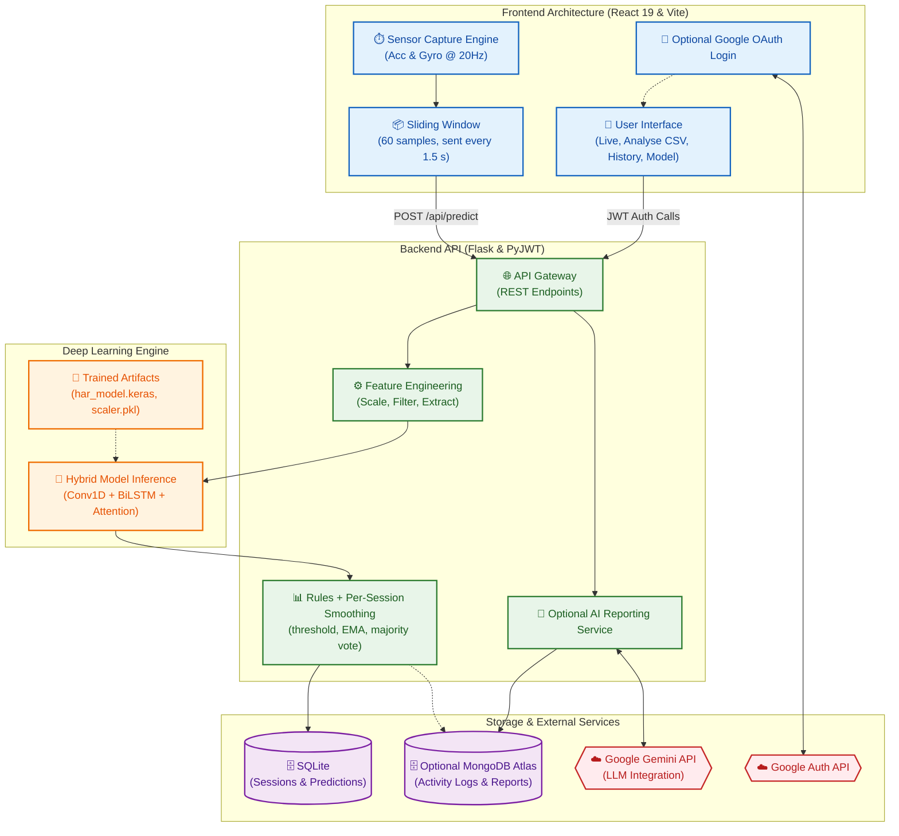
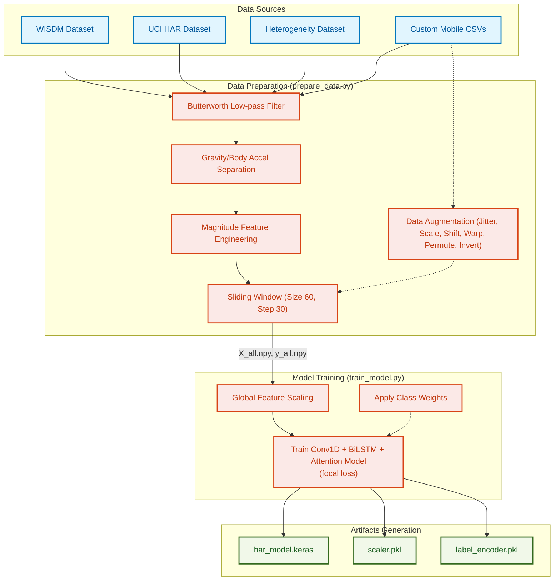

# Minor HAR - System Architecture

> Visual overview of system components, data flow, and training pipelines.

## System Architecture

The following diagram illustrates the real-time operational flow of the system. It shows how sensor data is captured on the frontend, processed by the Flask backend, classified by the hybrid deep learning model, and stored in a local SQLite database. Google sign-in, MongoDB and Gemini reports are an optional module (dashed boxes) that is enabled only when credentials are configured.

## Data & Training Pipeline

The offline training pipeline is responsible for merging multiple academic datasets with custom mobile recordings, engineering magnitude features, applying data augmentation, and training the `Conv1D + BiLSTM + Attention` model.

---

## Implementation

> Tools, technologies, and development details

### Tech Stack

| Category | Technologies Used | Details |
| :--- | :--- | :--- |
| **Frontend Language** | JavaScript, JSX, HTML5, CSS3 | Used for the web application UI and mobile browser sensor capture via Web APIs. |
| **Frontend Framework** | React 19, Vite | Fast, modern client-side framework with component-driven architecture. |
| **Backend Language** | Python 3.11 | Primary language for API routing, data processing, and ML training pipelines. |
| **Backend Framework** | Flask, Flask-CORS | Lightweight Python microframework serving the REST API and prediction endpoints. |
| **Machine Learning** | TensorFlow / Keras, Scikit-learn | Used for defining, training, and running inference on the Conv1D + BiLSTM + Attention model. |
| **Data Processing** | NumPy, SciPy, Pandas | Used heavily in the data preparation and runtime feature engineering. |
| **Database** | SQLite (built into Python) | Local storage of recording sessions and predictions; no setup required. |
| **Optional Database** | MongoDB Atlas (PyMongo) | Activity logs and health reports for the optional cloud module. |
| **Authentication (optional)** | Google OAuth, PyJWT | User login exchanging Google tokens for signed JWTs. |
| **External APIs (optional)** | Google Gemini API | AI-generated daily health summaries (not tested in the final version). |
| **Visualizations** | Chart.js, Framer Motion | Interactive timeline graphs and smooth UI animations on the React client. |

### Core Project Flow

1. **Capture**: The React frontend (`useSensorStream.js`) reads the phone's accelerometer and gyroscope at **20 Hz** (HTTPS page required on phones). A recorded file can be replayed instead; the dashboard labels this clearly as not live.
2. **Window**: The last **60 samples (3 seconds)** are sent every **30 new samples (1.5 seconds)**.
3. **Transmit**: Each window is sent over HTTP to the Flask `POST /api/predict` endpoint.
4. **Engineer**: Flask applies the same zero-phase Butterworth filtering and magnitude features as the training data, giving a `(1, 60, 8)` tensor.
5. **Infer**: The pre-trained Keras model outputs probabilities for 6 classes (Hand Activity, Jogging, Sports, Stairs, Still, Walking).
6. **Post-process**: Rules (near-zero motion → Still, confidence < 40% → Uncertain, intensity gating) and per-session smoothing (moving average + majority vote over 5 windows) stabilise the label.
7. **Store**: Predictions are saved per session in SQLite and can be viewed in History and exported as CSV or PDF. If the optional cloud module is configured, signed-in users' predictions are also logged to MongoDB for Gemini daily reports.
